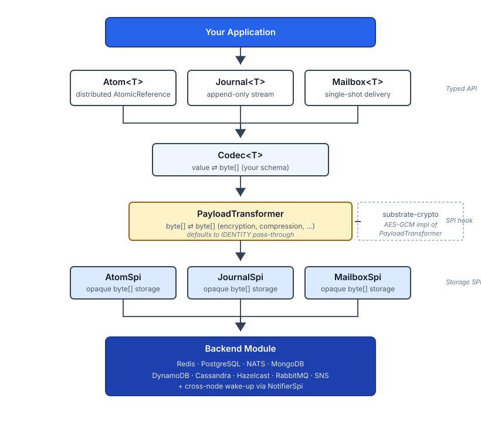

# Concepts

Atom, Journal and Mailbox are different structures with the same shape: a factory that creates
or connects to them by name, a time-to-live on everything, a small lifecycle, and one
subscription model. This page covers what they share. The [Atom](../primitives/atom.md),
[Journal](../primitives/journal.md) and [Mailbox](../primitives/mailbox.md) pages cover what is
particular to each.

## How Substrate is put together

{ width="760" }

- **Primitives** — `Atom`, `Journal`, `Mailbox` — are the typed API your code uses. They handle
  serialization, subscriptions, TTL checks and cross-node notification.
- **Codec** turns your values into bytes and back. Substrate uses whichever
  [Codec](https://jwcarman.github.io/codec/) backend you add: Jackson, Gson, Protobuf and others.
- **`PayloadTransformer`** rewrites those bytes on their way to and from storage. It does
  nothing by default; [`substrate-crypto`](../guides/encryption.md) replaces it with AES-GCM
  encryption.
- **SPIs** (`AtomSpi`, `JournalSpi`, `MailboxSpi`) are pure storage: they read and write bytes,
  and own no threads and no callbacks.
- **Backend modules** implement the SPIs for one technology each. Most also implement
  `NotifierSpi`, the channel nodes use to tell each other that something changed.

## Names and keys

Every primitive is identified by a name you choose, such as `session:abc` or `orders:42`. Two
handles with the same name, on any nodes, refer to the same primitive. The backend stores it
under a key made of a configurable prefix and the name; each backend page lists its prefixes.
`key()` on a handle returns that backend key.

Names are not checked against each other across primitive types: an Atom and a Journal may share
a name without colliding, because their prefixes differ.

## Creating and connecting

Each factory has two ways to get a handle.

**`create(...)` is eager.** It writes to the backend immediately: the initial value and lease
for an Atom, an empty journal, an empty mailbox. Use it in the code that owns the primitive.

**`connect(...)` is lazy.** It returns a handle without touching the backend. The first real
operation — `get`, `set`, `append`, `deliver`, `subscribe` and so on — checks once that the
primitive exists and throws `AtomNotFoundException`, `JournalNotFoundException` or
`MailboxNotFoundException` if it doesn't. After that check the handle behaves exactly like one
from `create`. Use it in code that observes or feeds a primitive someone else created.

`delete()` never performs that check, so cleanup code can call it whether or not the primitive
still exists.

What `create` does when the name is taken depends on the primitive:

| Factory | Name already in use |
|---|---|
| `AtomFactory.create` | throws `AtomAlreadyExistsException` |
| `JournalFactory.create` | throws `JournalAlreadyExistsException` |
| `MailboxFactory.create` | replaces the existing mailbox, with the new TTL |

Only the name is compared: an existing atom with a different value or TTL is still a collision.
Get-or-create is a `try`/`catch`:

```java
Atom<Session> atom;
try {
  atom = atoms.create(name, Session.class, initial, Duration.ofHours(1));
} catch (AtomAlreadyExistsException _) {
  atom = atoms.connect(name, Session.class);
}
```

## Time-to-live

Nothing in Substrate lives forever unless something keeps it alive. Each primitive uses TTLs
differently.

**Atom: a lease.** `create`, `set`, `compareAndSet` and `touch` each pass a TTL, and each resets
the lease. An atom lives as long as something keeps renewing it.

**Journal: three TTLs.**

- The *inactivity TTL*, given to `create`, ends the journal if nothing is appended for that long.
  Every `append` resets it.
- The *entry TTL*, given to each `append`, is how long that entry is kept. `Duration.ZERO` means
  no TTL. Some backends manage retention for the whole stream rather than per entry and ignore
  it.
- The *retention TTL*, given to `complete`, is how long a completed journal stays readable.
  `Duration.ZERO` means no TTL.

**Mailbox: a lifetime.** Set once by `create` and never renewed. A mailbox is created, delivered
to, read, and gone.

### Upper limits

Each TTL has a ceiling, so a mistake such as `Duration.ofDays(365)` fails loudly instead of
filling the backend. A TTL above its ceiling throws `IllegalArgumentException`, as does a
negative TTL. The atom lease, the journal inactivity TTL and the mailbox lifetime must also be
greater than zero; the entry and retention TTLs accept `Duration.ZERO`, meaning no TTL.

| TTL | Property | Default ceiling |
|---|---|---|
| Atom lease | `substrate.atom.max-ttl` | 24 hours |
| Journal inactivity | `substrate.journal.max-inactivity-ttl` | 24 hours |
| Journal entry | `substrate.journal.max-entry-ttl` | 7 days |
| Journal retention | `substrate.journal.max-retention-ttl` | 30 days |
| Mailbox lifetime | `substrate.mailbox.max-ttl` | 30 minutes |

### When expired data disappears

An expired primitive is treated as gone from the moment its TTL runs out: operations throw the
matching `*ExpiredException` and subscriptions end with `Expired`. Removing the data from storage
is the backend's job. Backends with native expiry — Redis, DynamoDB, MongoDB and others — do it
themselves. For those without it, such as PostgreSQL, a background sweeper deletes expired rows
on a schedule; see [Operating in Production](../guides/operating.md#sweeping).

## Lifecycles

Each primitive has a small state machine, and subscriptions report its end states.

**Atom** — *alive*, then *expired* (the lease ran out) or *deleted*. Once it is dead, `set`,
`compareAndSet` and `get` throw `AtomExpiredException`; `touch` returns `false`.

**Journal** — *active*, then *completed*, then gone.

- *Active*: accepts `append`.
- *Completed*: `complete(retentionTtl)` was called. `append` throws `JournalCompletedException`.
  Existing entries stay readable, and subscribers drain them, until the retention TTL elapses.
- *Expired*: the inactivity TTL elapsed with no append, or the retention TTL elapsed after
  completion. Operations throw `JournalExpiredException`.

`delete()` ends a journal in any state.

**Mailbox** — *empty*, then *delivered*, then expired or deleted.

- *Empty*: created; `deliver` hasn't succeeded yet. Subscribers wait.
- *Delivered*: one `deliver` succeeded. A second throws `MailboxFullException`. Every subscriber,
  including ones that subscribe later, receives the value and then `Completed`.
- The mailbox ends when its TTL elapses or it is deleted.

## Subscriptions

All three primitives deliver changes the same way, in one of two styles.

### Blocking

`subscribe()` returns a `BlockingSubscription<T>`. Call `next(Duration)` to wait for the next
result; it returns as soon as there is one, or when the timeout elapses. This style suits
virtual threads, where blocking is cheap, and code that already has a loop, such as a
Server-Sent Events handler.

`BlockingSubscription` is `AutoCloseable`; closing it cancels it, so try-with-resources cleans up:

```java
try (BlockingSubscription<Snapshot<Session>> sub = atom.subscribe()) {
  while (sub.isActive()) {
    switch (sub.next(Duration.ofSeconds(30))) {
      case NextResult.Value<Snapshot<Session>>(var snapshot) -> render(snapshot.value());
      case NextResult.Timeout<Snapshot<Session>> _ -> sendKeepAlive();
      case NextResult.Expired<Snapshot<Session>> _ -> log.info("session expired");
      case NextResult.Deleted<Snapshot<Session>> _ -> log.info("session deleted");
      case NextResult.Errored<Snapshot<Session>>(var cause) -> log.error("failed", cause);
      case NextResult.Completed<Snapshot<Session>> _, NextResult.Cancelled<Snapshot<Session>> _ -> {}
    }
  }
}
```

### Callbacks

Pass a `Subscriber<T>` instead, and Substrate calls it from a virtual thread of its own. The
method returns a `Subscription` for cancelling:

```java
Subscription sub = atom.subscribe(snapshot -> render(snapshot.value()));
// later
sub.cancel();
```

`Subscriber` has a method for each outcome; only `onNext` is required. To handle the others
without writing a class, pass a customizer instead:

```java
Subscription sub = atom.subscribe(cfg -> cfg
    .onNext(snapshot -> render(snapshot.value()))
    .onExpired(() -> log.info("session expired"))
    .onDeleted(() -> log.info("session deleted"))
    .onError(cause -> log.error("subscription failed", cause)));
```

### Outcomes

`next(Duration)` returns a `NextResult<T>`, a sealed interface with seven cases. A `switch` that
names all seven needs no `default`, and the compiler reports a missing one.

| `NextResult` | Callback | Meaning | Ends the subscription |
|---|---|---|:---:|
| `Value(T value)` | `onNext(T)` | A new value. | no |
| `Timeout()` | — | The timeout passed with nothing new. | no |
| `Completed()` | `onCompleted()` | The primitive finished: a completed journal was drained, or a mailbox's value was delivered. Atoms never complete. | yes |
| `Expired()` | `onExpired()` | The primitive's TTL ran out. | yes |
| `Deleted()` | `onDeleted()` | Someone deleted the primitive. | yes |
| `Errored(Throwable cause)` | `onError(Throwable)` | An unexpected failure, such as the backend being unreachable. | yes |
| `Cancelled()` | `onCancelled()` | This subscription was cancelled locally — by `cancel()`, `close()` or application shutdown. The primitive itself is unaffected. | yes |

`isTerminal()` on a result tells you whether it ended the subscription. After a terminal result,
`isActive()` is `false` and every further `next` returns the same result. If the thread blocked
in `next` is interrupted, the subscription ends and the interrupt flag is restored.

What a subscription delivers differs by primitive:

- **Atom** subscriptions *coalesce*: they deliver the current value, not every intermediate one.
  If the atom changes three times between two calls to `next`, you get the latest
  `Snapshot` once.
- **Journal** subscriptions deliver every entry, in order. Entries wait in a bounded in-memory
  queue per subscription (`substrate.journal.subscription.queue-capacity`, 1024 by default); when
  it is full, reading from the backend pauses until the consumer catches up.
- **Mailbox** subscriptions deliver the single value, then `Completed`.

## Snapshots and staleness tokens

Atom reads return a `Snapshot<T>`, not a bare value:

```java
public record Snapshot<T>(T value, String token) {}
```

The token identifies the write that produced the value. Every write produces a new token, even
when it stores the same value again, so tokens tell writes apart where values cannot. Treat a
token as opaque and compare it only with `equals`.

You rarely look at a token directly. You pass the snapshot back:

- to `subscribe(lastSeen)`, to be told only about writes after the one you have seen; and
- to `compareAndSet(expected, ...)`, to write only if nobody else has written since.

## Journal entries

Journal subscriptions deliver `JournalEntry<T>`:

```java
public record JournalEntry<T>(String id, String key, T data, Instant timestamp) {}
```

- `id` — the entry's ID, unique within the journal and increasing with each append. Its format
  depends on the backend: a Redis stream ID, a sequence number, a time-based UUID. Treat it as an
  opaque string, and pass it to `subscribeAfter` to resume after that entry.
- `key` — the journal's backend key.
- `data` — the payload, decoded.
- `timestamp` — when the entry was appended.

## Generic types

The factories take a `Class<T>` for simple types. When the value type has type parameters of its
own, such as `List<Order>`, a `Class` cannot describe it; pass a Codec `TypeRef` instead:

```java
import org.jwcarman.codec.TypeRef;

Atom<List<Order>> cart =
    atoms.create("cart:42", new TypeRef<List<Order>>() {}, List.of(), Duration.ofHours(1));
```

Each factory method that takes a `Class<T>` has a `TypeRef<T>` overload.

## How nodes find out about changes

When a node writes — `set`, `append`, `deliver`, `complete`, `delete` — it also publishes a small
notification naming the primitive and what happened. Every node receives it through the
`NotifierSpi` its backend module provides: Redis pub/sub, PostgreSQL `LISTEN`/`NOTIFY`, a NATS
subject and so on. A node with a subscription on that primitive wakes and reads the new state
from the backend.

Notifications are a wake-up call, not the data, and Substrate does not depend on them arriving.
Each active subscription also re-reads its primitive at least once a second. A lost notification
delays a change by up to a second; it never loses one.

Two consequences:

- **Every active subscription reads from the backend about once a second**, as well as on each
  notification. Plan backend capacity for the number of concurrent subscriptions, not just the
  write rate. See [Operating in Production](../guides/operating.md).
- **The notifier can be a different technology from the storage.** A backend without a notifier
  of its own — MongoDB, DynamoDB, Cassandra, etcd — can be paired with one that has one, such as
  `substrate-sns` or `substrate-rabbitmq`. Without any notifier module, the in-memory notifier
  only reaches the local node, and other nodes see changes through the once-a-second re-read. See
  [Choosing a Backend](../backends/index.md#notifiers).

## Threads and shutdown

Each subscription runs a *feeder* on its own virtual thread, which reads the backend and hands
results to the subscription. A callback subscription adds a second virtual thread that calls
your `Subscriber`. Both end when the subscription ends.

When the Spring context shuts down, Substrate cancels every open subscription before the web
server's graceful shutdown starts. Blocked `next` calls return `Cancelled`, callbacks receive
`onCancelled`, and long-lived requests such as Server-Sent Events streams end promptly instead of
holding shutdown open. Subscriptions created after shutdown has begun are cancelled at once.

## Exceptions

Every Substrate exception is unchecked. [Exceptions](../reference/exceptions.md) lists each one
and when it is thrown.
